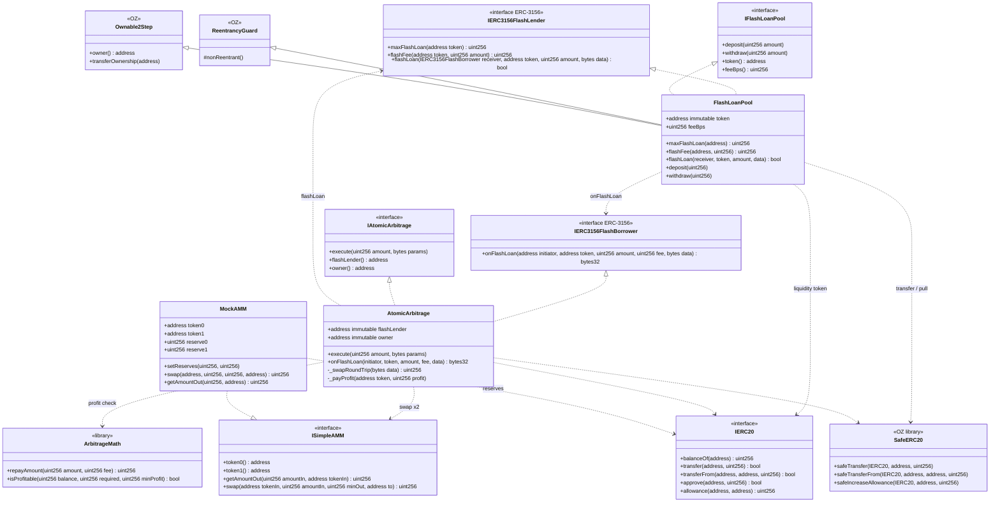
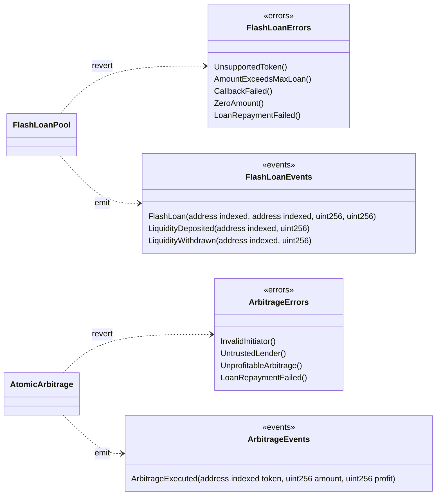
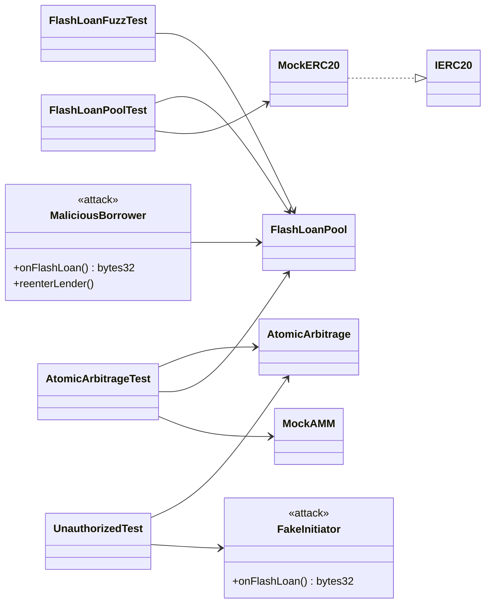
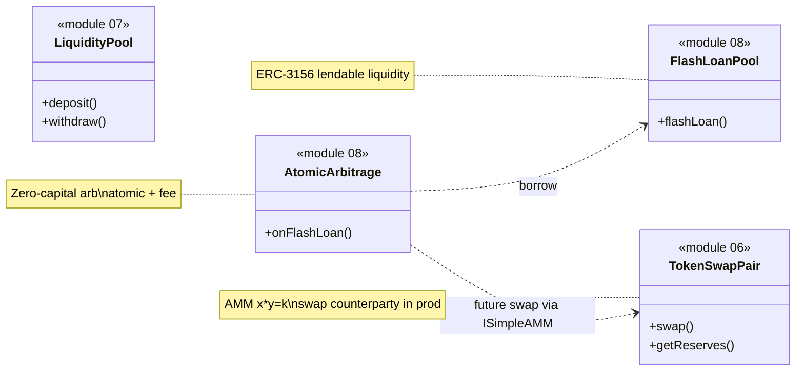

> 🌐 **English** · [Español](./diagrama-clases-ES.md)

# Class diagram — Flash Loans & Atomic Arbitrage

**To-be** structural model (module 08). Contracts, ERC-3156 interfaces, mocks, and tests.

## 1. Main diagram (UML / Mermaid)



## 2. Errors and events



## 3. Tests and actors



## 4. Responsibilities

| Artifact | Role |
|-----------|-----|
| `FlashLoanPool` | Holds liquidity, lends ERC-20, charges the fee, anti-reentrancy lock |
| `AtomicArbitrage` | Initiates the loan, authenticates the callback, swaps, repays, sends profit to owner |
| `ArbitrageMath` | Stateless `repayAmount` and `isProfitable` |
| `ISimpleAMM` / `MockAMM` | token0/token1 pair with settable reserves to create an imbalance |
| `ReentrancyGuard` | Prevents reentering `flashLoan` during the callback |
| `Ownable2Step` | Pool liquidity admin (deposit/withdraw v1) |
| `SafeERC20` | Transfers and allowance for the borrowed token |
| `MaliciousBorrower` | Attempts to reenter or not repay the loan |

## 5. Dependencies (summary)

```
FlashLoanPool
  ├── inherits   → ReentrancyGuard, Ownable2Step
  ├── implements → IERC3156FlashLender, IFlashLoanPool
  ├── uses       → SafeERC20
  ├── calls      → IERC3156FlashBorrower.onFlashLoan
  ├── emits      → FlashLoan / LiquidityDeposited / LiquidityWithdrawn
  └── reverts    → UnsupportedToken / AmountExceedsMaxLoan / CallbackFailed /
                    ZeroAmount / LoanRepaymentFailed

AtomicArbitrage
  ├── implements → IERC3156FlashBorrower, IAtomicArbitrage
  ├── immutables → flashLender, owner
  ├── uses       → ArbitrageMath, SafeERC20, ISimpleAMM (×2)
  ├── calls      → IERC3156FlashLender.flashLoan
  ├── emits      → ArbitrageExecuted
  └── reverts    → InvalidInitiator / UntrustedLender /
                    UnprofitableArbitrage / LoanRepaymentFailed

MockAMM
  ├── implements → ISimpleAMM
  └── setReserves → creates an artificial spread between AMM A and AMM B
```

## 6. Solidity layout

### FlashLoanPool

1. Imports / interfaces / libraries  
2. Contract `FlashLoanPool`  
3. Immutables (`token`) + state (`feeBps`)  
4. Events → Errors → Modifiers (inherited `nonReentrant`)  
5. External: `maxFlashLoan`, `flashFee`, `flashLoan`, `deposit`, `withdraw`  
6. Internal: `_chargeRepayment`

### AtomicArbitrage

1. Imports  
2. Immutables (`flashLender`, `owner`) — **no** profits mapping  
3. Events → Errors  
4. External: `execute`, `onFlashLoan`  
5. Internal: `_swapRoundTrip`, `_payProfit` (only `safeTransfer` to owner)

## 7. Relationship with modules 06 and 07



In v1 the tests use `MockAMM`. A later integration can adapt `ISimpleAMM` to module 06's `TokenSwapPair`. Module 07 is not required for the flash loan.
