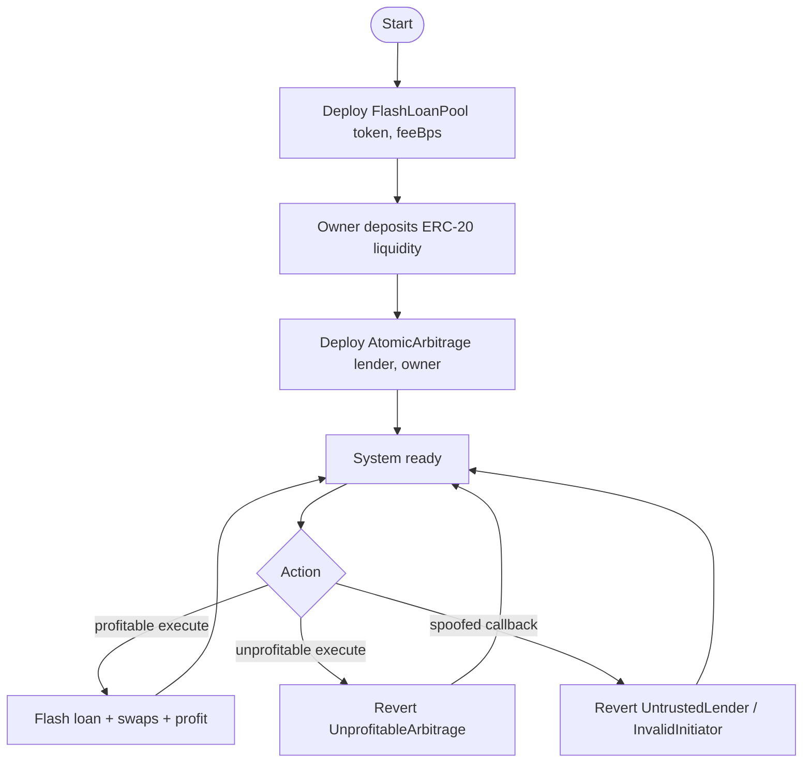
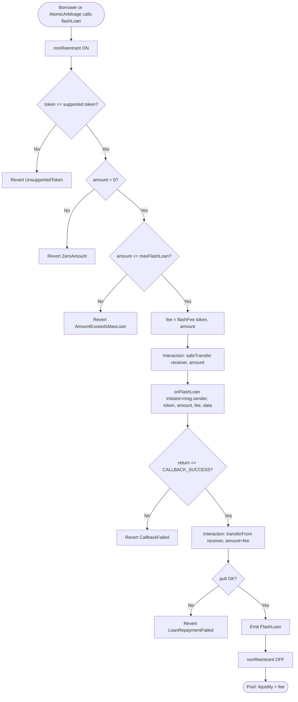
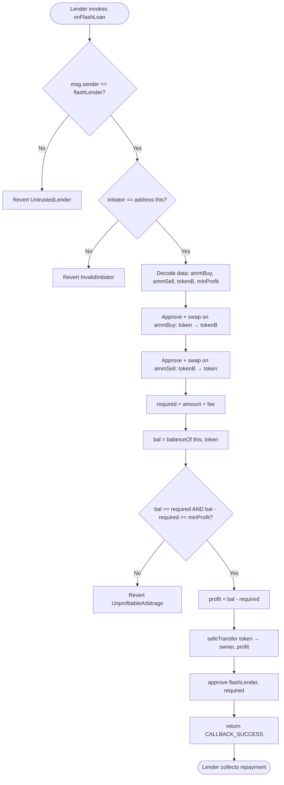
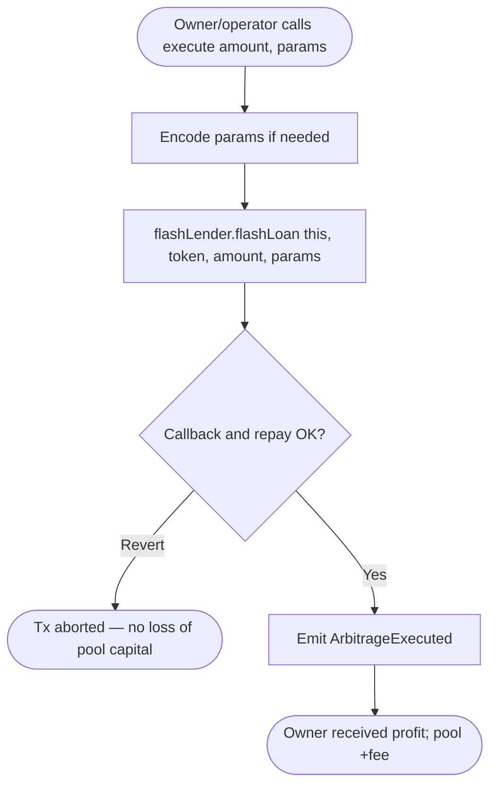
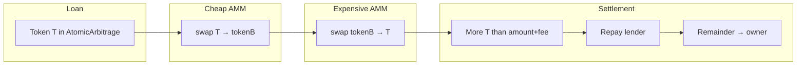
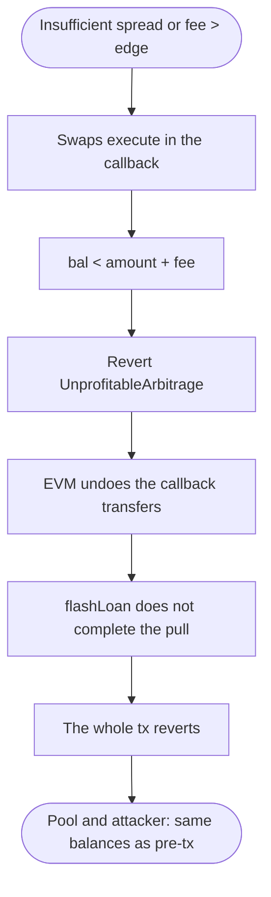
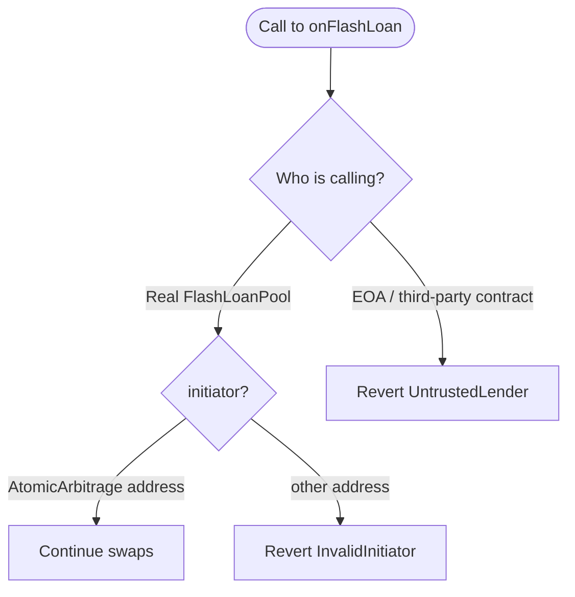
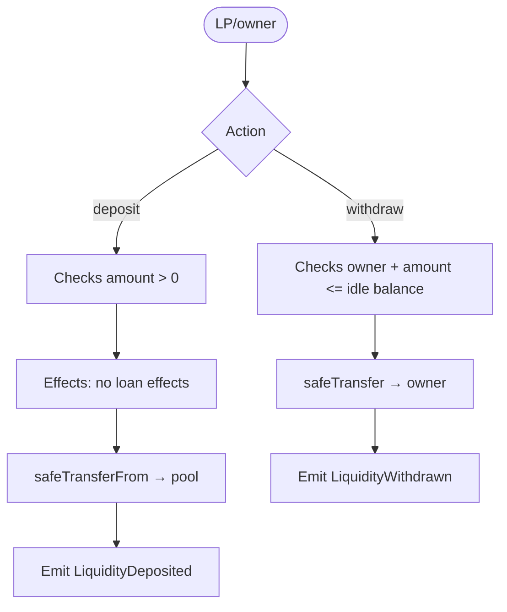

> 🌐 **English** · [Español](./diagrama-flujo-ES.md)

# Flow diagram — Flash Loans & Atomic Arbitrage

**To-be** business flows (v1). See also [flujograma-EN.md](./flujograma-EN.md) and [PLANIFICACION-EN.md](./PLANIFICACION-EN.md).

## 1. System lifecycle

## 2. ERC-3156 `flashLoan` flow (lender)

## 3. `onFlashLoan` flow (AtomicArbitrage)

## 4. Execute flow (operator entry point)

`execute` does not store the profit: the callback transfers it to the immutable `owner`.

## 5. Swap flow (round-trip between two AMMs)

Trade direction (example): the borrowed token is sold where it is **overvalued** and bought back (via an intermediate token) where it is **undervalued**, or the reverse path depending on which reserve is imbalanced. The params in `data` set `ammBuy` / `ammSell`.

## 6. Unprofitable flow (atomic guarantee)

There is no "half loan": either it is repaid with the premium or no effective loan ever happened.

## 7. Authentication flow (unauthorized callers)

A contract cannot ask the pool for a flash loan "on behalf of" `AtomicArbitrage` and expect the callback to credit a different initiator: `initiator` is the `msg.sender` of `flashLoan`, and it must be `address(this)`.

## 8. Pool liquidity flow (deposit / withdraw)

`maxFlashLoan` = current token balance in the pool (v1: no nested loans).

## Legend

| Symbol | Meaning |
|---------|-------------|
| Rectangle | On-chain process / action |
| Diamond | Decision / validation |
| Oval | Start / end |

## CEI order

| Step | `flashLoan` (pool) | `onFlashLoan` (arb) |
|------|--------------------|---------------------|
| **Checks** | token, amount, maxLoan | lender, initiator |
| **Effects** | reentrancy lock | (no profit SSTORE) |
| **Interactions** | transfer out → callback → transferFrom repay | AMM swaps → transfer profit → approve |
| **Final checks** | magic value + pull OK | `bal >= required` |
