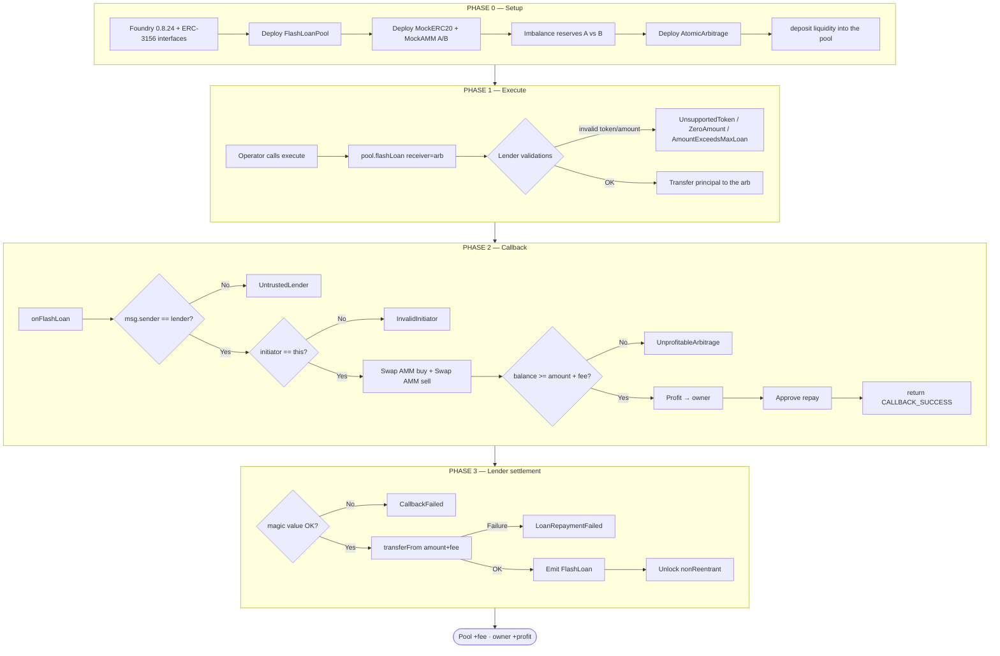
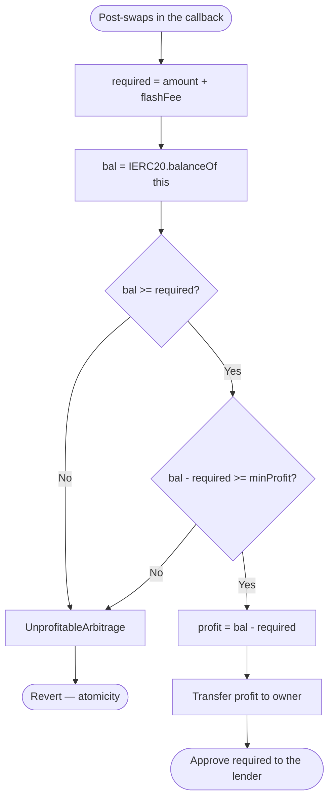
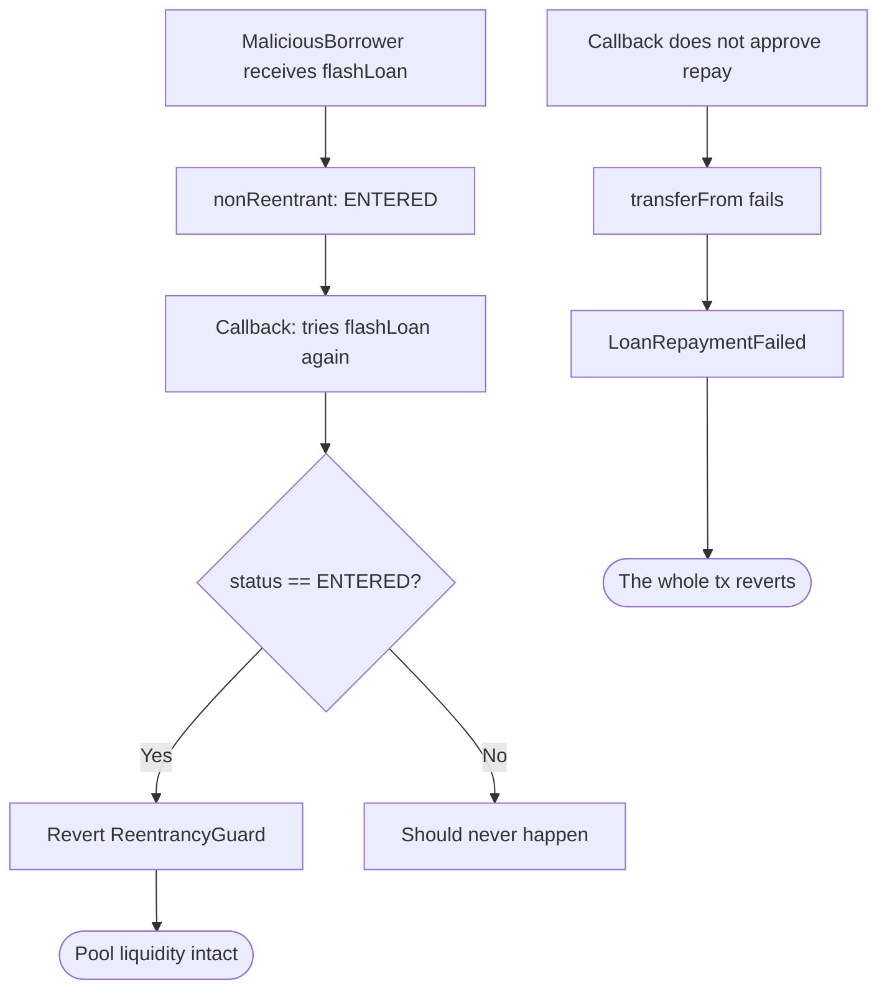
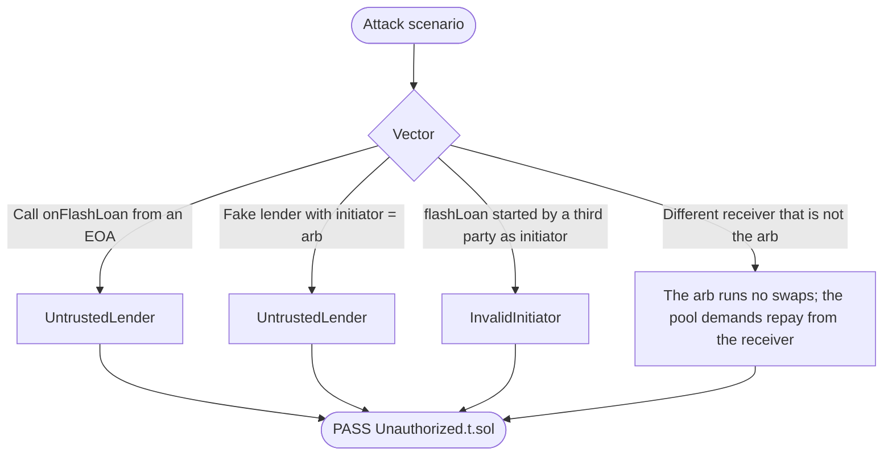
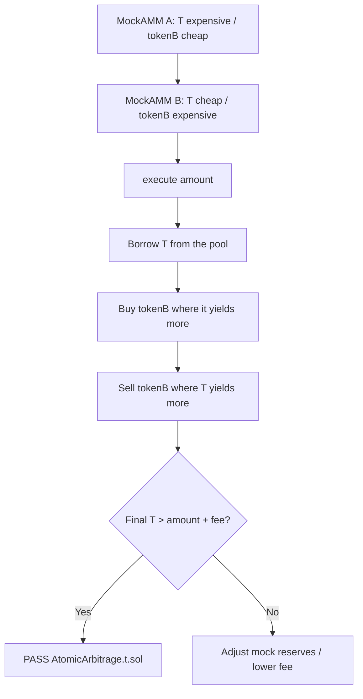

> 🌐 **English** · [Español](./flujograma-ES.md)

# Project flowchart — Flash Loans & Atomic Arbitrage

Operational **to-be** flowchart (v1): setup → liquidity → execute → callback → repay → security → TDD.

## 1. Master system flowchart

## 2. Detailed profitability flowchart

## 3. Security flowchart (reentrancy + CEI)

## 4. Unauthorized callback flowchart

In ERC-3156, `initiator` is whoever called `flashLoan`. If a third party calls `pool.flashLoan(arb, ...)`, `initiator` would be that third party and `AtomicArbitrage` reverts with `InvalidInitiator`. Only `execute()` (the contract itself) is a valid initiator.

## 5. Development pipeline flowchart (TDD)

```mermaid
flowchart LR
    A[.cursorrules] --> B[Planning docs]
    B --> C[Red lender tests]
    C --> D[FlashLoanPool]
    D --> E[Red arb + AMM mock tests]
    E --> F[AtomicArbitrage + auth]
    F --> G[Unprofitable revert]
    G --> H[Unauthorized + reentrancy]
    H --> I[Fuzz + liquidity invariant]
    I --> J[Optional fork + gas + NatSpec]
    J --> K([Module closed])
```

## 6. Flow ↔ function ↔ invariant matrix

| Flowchart step | Function | Invariant / postcondition |
|---------------------|---------|----------------------------|
| Deposit liquidity | `FlashLoanPool.deposit` | `balance(pool)` ↑; `maxFlashLoan` ↑ |
| Loan cap | `maxFlashLoan` | `<= IERC20.balanceOf(pool)` |
| Fee | `flashFee` | `amount * feeBps / 10_000` |
| Loan | `flashLoan` | On success: pool ≥ pre + fee |
| Callback auth | `onFlashLoan` | only lender + initiator = this |
| Round-trip | `_swapRoundTrip` | borrowed token returns to the arb |
| Profit | `_payProfit` | owner ↑; **no** SSTORE of accumulated profit |
| Unprofitable | `onFlashLoan` | revert; pre-tx balances |
| Fake callback | `onFlashLoan` | `UntrustedLender` / `InvalidInitiator` |
| Reentrancy | `flashLoan` | second call reverts |
| Repay | `transferFrom` | `LoanRepaymentFailed` if allowance/balance is short |

## 7. Two-AMM flowchart (test imbalance)

Reserves are set in `setUp()` so that the A→B path is **deterministically** profitable in the happy-path test and **not** profitable in the revert test.

## 8. How to read these diagrams

1. **Setup**: pool with liquidity, two AMMs with different prices, arb pointing to the lender.
2. **Execute → flashLoan**: capital leaves the pool only inside a tx that must close with a repay.
3. **Callback**: authentication first; swaps next; profit via direct transfer; then approve.
4. **Settlement**: magic value + `transferFrom`; if anything fails, **everything** reverts (including the profit).
5. **TDD**: red lender tests → pool → arb tests → auth/unprofitable → fuzz → close-out.
